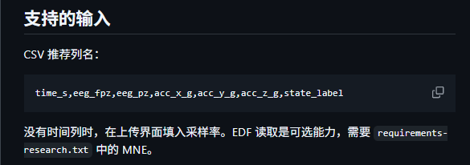

# NeuroTeam：可穿戴 EEG/IMU 数据与团队协作平台

这是一个大创项目的数据工作台。它解决的问题很具体：

1. 把 EEG（脑电）和 IMU（运动）数据安全地传到团队主机；
2. 检查时间轴、通道、缺口、噪声和运动伪迹；
3. 生成质量报告、窗口特征和处理后的数据；
4. 让组员共用一个任务队列，查看结果并复核；
5. 没有真实设备时，用模拟设备验证完整采集流程。

> 当前结果是数据验收和科研预处理的辅助结论，不是医疗诊断，也不能把质量分当成模型准确率。

## 先看一张图：推荐的 CSV 长什么样



图中第一行是 CSV 的“表头”，后面的每一行才是一行真实数据。推荐表头为：

```text
time_s,eeg_fpz,eeg_pz,acc_x_g,acc_y_g,acc_z_g,state_label
```

它的含义如下：

| 列名 | 通俗解释 | 常用单位 |
|---|---|---|
| `time_s` | 从本次记录开始算起的时间；必须按时间递增 | 秒 |
| `eeg_fpz` | 位于 Fpz 电极位置的脑电通道 | 微伏（µV） |
| `eeg_pz` | 位于 Pz 电极位置的脑电通道 | 微伏（µV） |
| `acc_x_g` | 头部左右方向的加速度 | g（1 g ≈ 9.81 m/s²） |
| `acc_y_g` | 头部前后方向的加速度 | g |
| `acc_z_g` | 头部上下方向的加速度 | g |
| `state_label` | 这一刻对应的状态，例如 `rest`、`focused`、`sleep` | 文本 |

一个最小例子：

```csv
time_s,eeg_fpz,eeg_pz,acc_x_g,acc_y_g,acc_z_g,state_label
0.000,12.4,4.8,0.001,-0.002,1.003,rest
0.008,12.8,5.0,0.002,-0.001,1.002,rest
0.016,12.1,4.6,0.001,-0.002,1.004,rest
```

不需要完全照抄列名：

- EEG 列可以用 `eeg_` 开头，也可以使用 `Fpz`、`Pz`、`C3`、`C4` 等常见通道名；
- IMU 列可以包含 `acc`、`gyro` 或 `imu`；
- `state_label` 是推荐列，不是质量检查的必填列；
- 当前质量报告不会自动训练分类模型，`state_label` 也不会自动变成模型训练标签。

### 图里最后一句是什么意思

截图里写着“没有时间列时，在上传界面填入采样率”。这条说明需要区分使用方式：

- **当前网页上传**：CSV 需要时间列。没有 `time_s` 时，先补时间列，或在命令行模式提供 `--sample-rate`；
- **命令行处理**：可以直接提供源采样率，程序会自动生成时间轴；
- **EDF 文件**：时间轴和采样率通常由文件自己保存，读取 EDF 需要安装 MNE。

网页的上传界面里“目标采样率”表示处理后希望保留多少 Hz，不等于源数据的采样率，两者不要混用。

## 五分钟开始

### 1. 准备环境

需要：

- Windows PowerShell；
- Python 3.11 或更高版本；
- 团队共享时还需要 Tailscale。

在项目目录执行：

```powershell
.\scripts\setup.ps1 -Team
```

这条命令会创建 `.venv` 虚拟环境，并安装团队平台、EEG 处理和研究依赖。

### 2. 启动团队平台

只允许当前电脑访问：

```powershell
.\scripts\start_team_platform.ps1
```

通过 Tailscale 让组员访问：

```powershell
.\scripts\start_team_private.ps1
```

第二种方式只监听 Tailscale 私有地址。组员必须先加入同一个 Tailscale 网络，再打开负责人发来的私有网址；普通公网用户打不开，这是有意的安全设计。

需要登录 Windows 后自动启动时，可使用 `scripts/start_team_autostart.ps1`。它会检查端口是否已占用，并等待 Tailscale 就绪后再启动平台。具体计划任务配置见[团队共享平台部署](docs/团队共享平台部署.md)。

### 3. 登录或加入团队

- 第一个注册的账号自动成为管理员；
- 后续成员注册时必须填写团队邀请码；
- 用户名支持中文、英文、其他语言、空格、Emoji 和常见符号；
- 用户名为 1—32 个字符，团队内不能重名；
- 登录后可在右上角“设置”中修改用户名和密码；
- 修改用户名会同步更新历史任务里的提交者名称。

### 4. 上传数据

1. 打开“任务工作台”；
2. 填写容易辨认的任务名称；
3. 拖入 CSV 或 EDF；
4. 选择处理模式；
5. 点击“上传并开始分析”；
6. 在“团队任务”中查看状态，完成后点“详情”。

### 5. 没有硬件也可以先验收

点击“运行演示任务”。平台会生成固定、可重复的合成数据，用来验证读取、滤波、质量和报告流程。演示数据不对应真实受试者，不能用于判断脑状态。

## 支持的格式

### CSV

适合已经对齐时间轴的自采数据、公开数据转换结果和特征文件。

- 推荐 UTF-8 编码；
- `.csv` 是纯文本表格，不是 `.xlsx` 工作簿；
- 必须能识别至少一个 EEG 通道；
- 至少需要 2 行有效数据；
- 有时间列时自动检查排序、重复点和缺口；
- 没有时间列时，网页会拒绝；命令行可传 `--sample-rate`。

### EDF

EDF 是常见的生理信号格式，可以保存通道名、采样率、时间和标注。

- 网站支持 `.edf`；
- 读取依赖 MNE；
- 睡眠分期可额外上传 Hypnogram 标注 EDF；
- 文件能被 MNE 读取，不代表电极贴附、单位或通道名称一定正确，仍需复核。

### 其他格式

当前网站只接受 CSV 和 EDF。`.xlsx`、`.mat`、`.bdf`、`.set` 等格式需要先转换成 CSV/EDF，或在命令行扩展读取器后再接入。

## 用真实设备采集

进入“设备采集”，平台通过 BrainFlow 连接硬件。浏览器不会直接接触设备，真正连接设备的是运行平台后台的电脑。

### 内置设备

| 设备 | 连接方式 | 说明 |
|---|---|---|
| BrainFlow 模拟设备 | 内置模拟 | 只用于验证流程 |
| Muse 2 | 蓝牙 | 常见消费级 4 通道 EEG |
| Muse S | 蓝牙 | 实际通道能力以固件和 BrainFlow 为准 |
| OpenBCI Cyton | USB 串口 / Dongle | 研究型多通道 EEG |

### 自定义 BrainFlow 设备

如果设备不在预置列表中，可选择“自定义 BrainFlow 设备”，填写：

- 自定义设备名称；
- 设备对应的数字 BrainFlow Board ID；
- 连接方式：串口、蓝牙、网络 IP 或无需地址；
- 连接地址。

平台会把 Board ID 和连接参数直接交给 BrainFlow。实际能采到哪些 EEG、IMU 通道，以及采样率是多少，以 BrainFlow 读取到的硬件描述为准。

采集文件采用统一名称：

```text
sub-<匿名受试者>_task-<状态>_acq-<设备>_<日期-时间>.<扩展名>
```

例如：

```text
sub-s01_task-focused_acq-muse2_20261024-183000.csv
sub-s01_task-focused_acq-muse2_20261024-183000.edf
sub-s01_task-focused_acq-muse2_20261024-183000_metadata.json
```

## 平台会产生什么

| 文件 | 用途 | 是否需要长期保留 |
|---|---|---|
| `report.html` | 给人看的质量报告 | 建议 |
| `report.json` | 给程序读取的完整结果和参数 | 建议 |
| `features.csv` | 每个时间窗口的频带功率、幅度和质量指标 | 建议 |
| `processed.csv` | 滤波、重采样后的数据，体积通常较大 | 按需 |
| `*_metadata.json` | 设备、连接、通道、任务和文件哈希 | 建议 |

### 质量等级怎么理解

- `A`：整体较稳定；
- `B`：可用，但建议人工复核；
- `C`：质量偏低，需要重点检查；
- `D`：当前数据不适合直接进入模型。

这些等级是规则筛查结果，不是医生判断，也不是模型准确率。

## 常用界面功能

- **浅色/深色模式**：右上角切换，浏览器会记住选择；
- **自动同步**：可打开或关闭任务自动刷新；
- **账户设置**：修改用户名和密码；
- **任务详情**：查看参数、质量、通道、窗口、报告和下载文件；
- **删除**：支持单条删除、多选删除、全选和 `Shift` 连续区间选择；
- **采集记录**：可以下载 CSV、EDF、元数据，也可以提交分析；
- **数据资源**：查看数据集用途、许可和访问方式；
- **团队规范**：查看窗口、标签、命名和隐私约定。

正在处理的任务或采集不能删除，避免破坏后台任务。删除任务会一并清理上传文件和报告；删除采集记录会清理原始录制文件，但不会自动删除已经生成的分析任务。

## 命令行示例

```powershell
# 生成演示报告
.\.venv\Scripts\python.exe -m wearable_eeg demo --output reports/demo

# 处理带 time_s 的 CSV
.\.venv\Scripts\python.exe -m wearable_eeg process data/raw/example.csv --output reports/runs/example

# CSV 没有时间列时，提供源采样率
.\.venv\Scripts\python.exe -m wearable_eeg process data/raw/example.csv --sample-rate 128 --output reports/runs/example

# 使用研究后端
.\.venv\Scripts\python.exe -m wearable_eeg process data/raw/example.csv --backend research --output reports/runs/example

# 运行全部测试
.\scripts\run_team_tests.ps1
```

## 项目目录

```text
wearable_eeg/       EEG/IMU 读取、预处理、质量和报告代码
team_platform/      账号、任务队列、设备采集和团队 API
team_web/           团队网页
web/                本地数据质量网页
tests/              自动化测试
docs/               使用说明、规范和部署文档
scripts/            安装、启动、测试脚本
data/raw/           原始数据，默认不提交 Git
reports/            报告、截图和验收结果
team_data/          共享平台运行数据，不提交 Git
```

## 常见问题

### 为什么网页打不开？

- 负责人是否启动了服务；
- 组员是否加入同一个 Tailscale 网络；
- 是否使用负责人发的私有地址，而不是 `127.0.0.1`；
- 服务主机是否休眠或断网。

### 为什么 CSV 上传失败？

先检查：

1. 文件是不是 CSV，不是 Excel；
2. 表头能否找到 EEG 列；
3. 是否含 `time_s` 等时间列；
4. 数据是否有至少两行；
5. 时间是否是秒，且没有把秒和毫秒混在一起。

### 为什么 IMU 没有参与质量检查？

需要至少三轴加速度列，通常命名为 `acc_x_g`、`acc_y_g`、`acc_z_g`。没有 IMU 时 EEG 仍可分析，但无法判断头部运动造成的伪迹。

### 为什么演示数据没有参考价值？

它是程序合成、固定随机种子、带模拟头动的测试信号，目的是验证流程。它能证明“程序能工作”，不能证明“模型能识别真实脑状态”。

## 继续阅读

- [平台整体说明](docs/平台说明.md)
- [新手数据与实验规范](docs/数据与实验规范.md)
- [上传校验与质量检查](docs/上传校验与质量检查.md)
- [设备采集说明](docs/设备采集说明.md)
- [团队共享平台部署](docs/团队共享平台部署.md)
- [数据与信号执行手册](docs/数据与信号执行手册.md)
- [项目术语表](docs/术语表.md)
- [实验记录规则](experiments/README.md)
